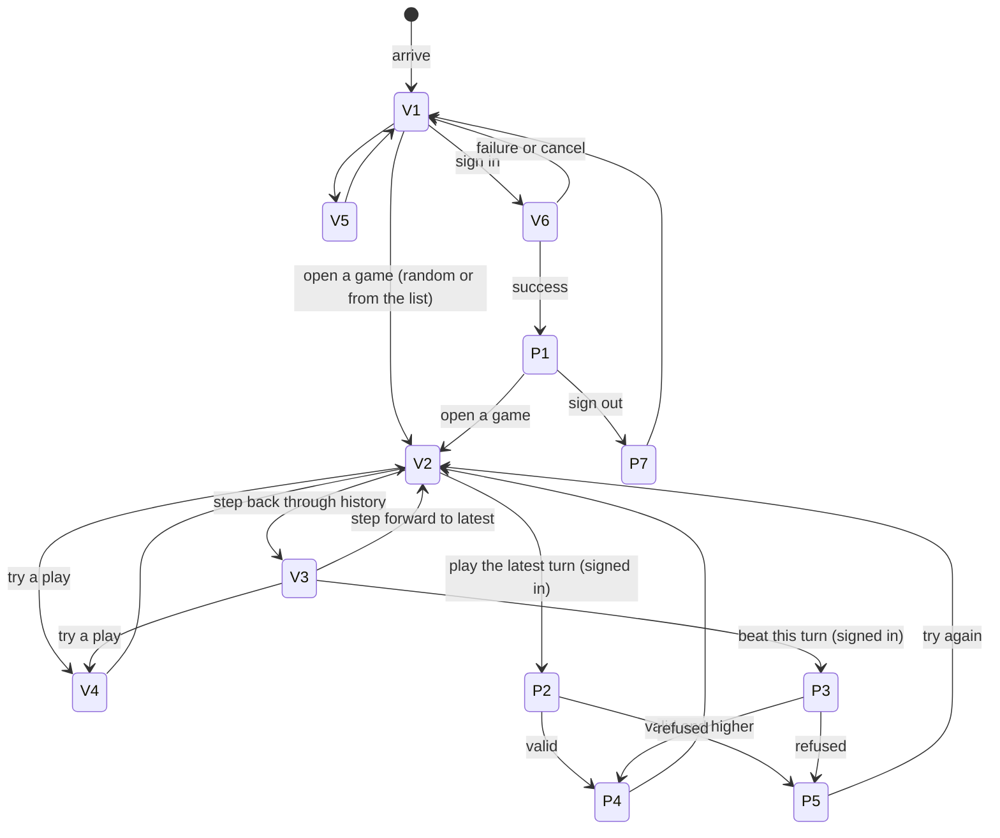

# Users, states and journeys

## Users

| User | How they use it | Priority |
|---|---|---|
| **Player** (consumer, signed in) | Browser, desktop or mobile; signs in with GitHub or Google | Primary |
| **Visitor** (consumer, anonymous) | Browser; browses games and leaderboards, tries plays without saving them | Primary |
| **Operator** | Operator views and configuration | Secondary |
| **Portfolio reviewer** (sponsor) | Reads the public repository; plays the hosted build as a visitor or player | Secondary: they judge the project, so the repository is part of the product |
| **GitHub and Google** (upstream services) | OAuth sign-in | Upstream: the game depends on their sign-in APIs |

The word list is a file in the repository, not a service.

## Game states (shared by all users)

| ID | State | Entered by |
|---|---|---|
| G1 | **Unplayed:** no turns yet; the rack holds the first 15 tiles of the draw order | Anyone opening a game number for the first time |
| G2 | **Open:** at least one turn, and a next turn can be played | A play; or a beaten turn reopening a complete or stalled game |
| G3 | **Complete:** the bag is empty and the rack has been played out | The last play |
| G4 | **Stalled:** no acceptable play can be made with the latest rack | The server's stall check after a play, a beaten turn or setup (GAME-9) |

## Visitor states

| ID | State | Risk |
|---|---|---|
| V1 | Browsing: active games list, random game | Low |
| V2 | Viewing a game at its latest turn | Low |
| V3 | Viewing a game at an earlier turn (stepping through history) | Low |
| V4 | Trying a play: placing tiles and seeing whether it's valid and what it would score, without saving | Low (abuse: rate limits) |
| V5 | Viewing leaderboards and player profiles | Low |
| V6 | Signing in | **Medium: security** |

## Player states

Players can do everything visitors can (V1–V5), and also:

| ID | State | Risk |
|---|---|---|
| P1 | Viewing "My games", with alerts for their beaten turns | Low |
| P2 | Making a play at the latest turn | **High: data integrity** |
| P3 | Beating an earlier turn | **High: data integrity** (invalidates history and changes other players' scores) |
| P4 | Play accepted: board, rack and scores updated | **High: data integrity** |
| P5 | Play refused (invalid placement or word, score not higher, game changed underneath) | Medium: the player must understand why |
| P6 | Suspended: can browse but not play | Medium |
| P7 | Signed out | Low |

## Operator states

| ID | State | Risk |
|---|---|---|
| O1 | Monitoring: health, errors, load, activity | Low |
| O2 | Suspending or reinstating a player | Medium |
| O3 | Setting rate limits | Medium: wrong limits can lock out players |
| O4 | Updating the word list (re-running the offensive-word filter) | Medium: changes which plays are valid from then on |

## Risk ranking (sets the order and depth of work)

There's no money or regulated data. The risks are corrupted game history, wrong scores, the two servers disagreeing, and abuse.

1. **P2–P4: accepting plays and beating turns.** Concurrency, invalidation and score updates. A mistake corrupts history or players' scores, and can't be undone.
2. **Determinism across the two servers:** the draw order from a game number, and scoring. If the servers disagree, the same game differs depending on which server answers.
3. **Rules correctness:** placement and word validation; scoring with premiums, blanks and the full-rack bonus.
4. **V6, P6, O2, O3: sign-in, suspension and rate limits.**
5. **Everything read-only:** browsing, history, leaderboards, profiles.

## Journeys

Transitions with requirements of their own are covered in `requirements.md` (for example, a play refused because the game changed while it was being made).
