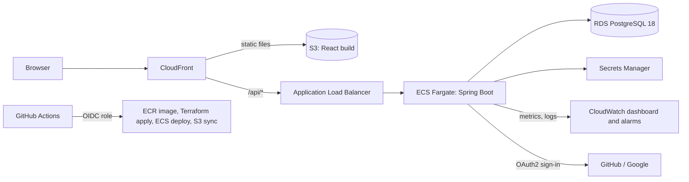
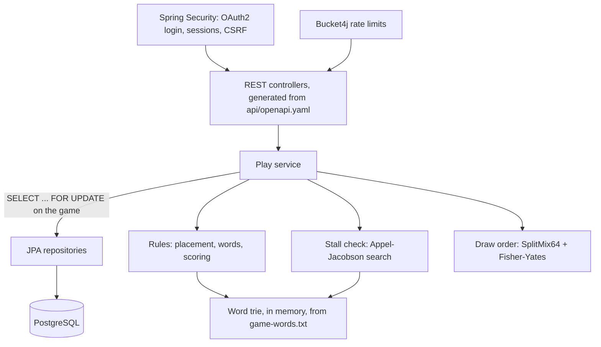

# Architecture (proposed, with RFC-0001)

The answer to the method's "How does it do it?" for the new app: its projects, their technologies, and how they fit together. Proposed with `rfc-0001-stack.md`; it becomes current when the RFC is approved.

## Projects

| Project | Runtime | Build and test |
|---|---|---|
| `api/` | OpenAPI 3.1 contract | Linted in CI; generates Java interfaces and TypeScript types |
| `server-java/` | Java 25, Spring Boot 4.1 (Spring MVC on virtual threads), Spring Data JPA, Spring Security OAuth2 Login, Spring Session JDBC, Bucket4j, Flyway, Actuator, Micrometer | Maven; JUnit, jqwik, Testcontainers |
| `web/` | React 19, TypeScript, TanStack Query, React Router, dnd-kit | Vite; Vitest, Testing Library, Playwright, axe-core |
| `acceptance/` | Gherkin features; Cucumber-JS step definitions in TypeScript using the generated API client | Run against any server URL; mock-oauth2-server for sign-in; fast-check for API-level properties |
| `infra/aws/` | Terraform 1.16, AWS provider | `terraform plan` in CI on pull requests; `apply` on merge |
| `data/`, `scripts/`, `tests/` | Word list, blocklist, tile derivation | Python 3, `unittest`; `build_wordlist.py --check` in CI |
| Load tests | k6 | Against a deployed environment |

## Deployed (AWS)

## Inside the server

One play is one database transaction: lock the game row; check the turn and the stale-history rule (PLAY-8); validate the placement and words; for an earlier turn, check the score is strictly higher and remove that turn and the later ones; write the turn; update the players' build-up and burn-down scores, in player-id order; run the stall check; bump the game's version; commit.

## Data owned (outline; the schema is designed per vertical slice)

| Store | Holds |
|---|---|
| `games` | Game number, version, number of turns, state (unplayed, open, complete, stalled) |
| `turns` | Per game and turn: player, tiles and positions, blank letters, words, score, time, the version at which it was written |
| `players` | Account, display name, sign-in identity, build-up and burn-down scores, suspension |
| `alerts` | Removed-turn alerts per player, and whether they've been seen |
| Spring Session tables | Server-side sessions |
| Rate-limit tables | Bucket4j buckets; the limits the operator sets |

Game numbers that have never been played have no rows: opening one computes its draw order and shows it unplayed (GAME-1).
